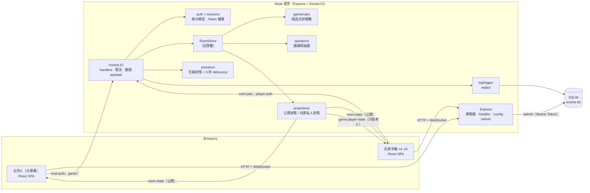
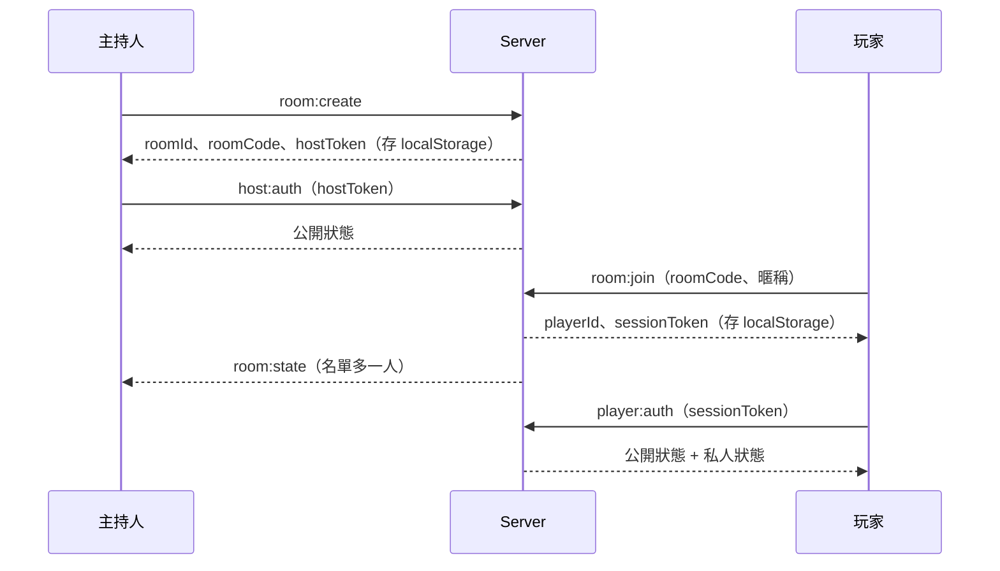
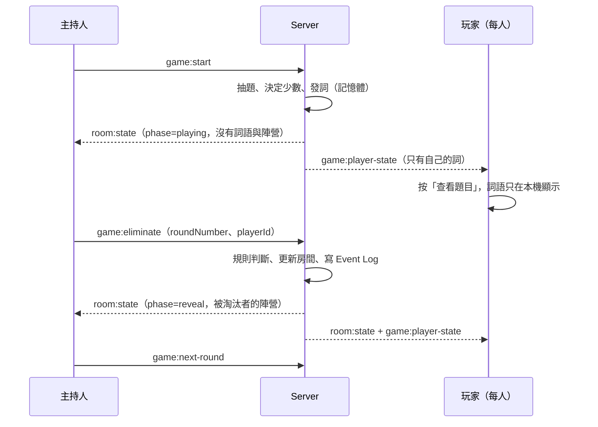

# 架構

一個 Node 程式同時提供網頁、WebSocket 與管理端點。遊戲狀態只在記憶體，Event Log 寫進 SQLite 檔。

## 架構圖

## 模組

| 路徑                            | 做什麼                                                                                                            |
| ------------------------------- | ----------------------------------------------------------------------------------------------------------------- |
| `src/shared/`                   | 前後端共用的型別：Socket.IO 協定（`protocol.ts`）、遊戲型別、公開與私人狀態型別。                                 |
| `src/server/game/`              | 遊戲規則。純函式，不碰時間、網路與全域狀態，亂數由外部傳入。`createGame`、`eliminate`、`skipRound`、`nextRound`。 |
| `src/server/questions/`         | 題庫、啟動時驗證、抽題（最近出過的題目不重複）。                                                                  |
| `src/server/rooms/`             | `RoomStore`（房間、玩家、遊戲，全在記憶體）、`SessionRegistry`（Token）、房間代碼、`projections`。                |
| `src/server/handlers/`          | Socket.IO 請求處理。每個請求依序：限流、payload 格式（zod）、身分與權限、遊戲狀態。                               |
| `src/server/auth.ts`            | 一條 socket 綁定哪個身分（主持人或某位玩家），綁定後不能換。                                                      |
| `src/server/broadcast.ts`       | 頻道命名與廣播。公開狀態與私人狀態走不同頻道。                                                                    |
| `src/server/presence*.ts`       | 玩家與主持人的在線狀態。最後一條連線斷掉 3 秒後才公布離線。                                                       |
| `src/server/log/`               | Event Log：寫入 SQLite、`redact` 去除秘密、清理 30 天前的資料。                                                   |
| `src/server/admin/`             | `/admin` 唯讀端點，要 Bearer Token。                                                                              |
| `src/client/net/`               | 連線層：`ConnectionStore`（驗證、重連、請求逾時）、Token 存取、React hooks。                                      |
| `src/client/pages/host/`        | 主持人畫面：Lobby、遊戲中、揭曉、結束。                                                                           |
| `src/client/pages/player/`      | 玩家手機畫面：加入表單、等待、題目卡、揭曉、結束。                                                                |
| `src/client/ui/`、`components/` | 設計系統（`tokens.css`）、按鈕、頭像、確認視窗、QR Code、封面。                                                   |

## 資料流

### 開房間與加入

### 一輪

所有規則判斷都在 Server。Client 送出的是「意圖」（淘汰誰），Server 檢查身分、phase、輪數、對象才執行。重複或過時的操作回 `ROUND_MISMATCH`、`INVALID_PHASE`，或是回 ok 但只記 `OPERATION_IGNORED`。

## 秘密資料怎麼隔離

秘密資料是：每位玩家的詞語、陣營（遊戲結束前）、Token。

1. **只有一個出口。** `Room` 物件含有完整的遊戲狀態，不能直接送出。所有送給 Client 的資料都要經過 `src/server/rooms/projections.ts` 的兩個函式：
   - `toPublicRoomState`：房間代碼、phase、輪數、玩家名單（暱稱、頭像、是否淘汰、是否在線）、最近一次淘汰的陣營；遊戲結束後才多一個 `result`（兩個詞語與所有人的陣營）。
   - `toPlayerPrivateState`：只有該玩家自己的 `secretWord`、是否淘汰、phase、輪數。
2. **頻道分開。** 綁定身分時 socket 加入頻道：`room:{roomId}`（所有人）、`host:{roomId}`（主持人）、`player:{playerId}`（該玩家）。公開狀態發到房間頻道，私人狀態只發到 `player:{playerId}`，主持人沒有加入任何玩家頻道，所以收不到任何人的詞語。
3. **身分只綁一次。** 一條 socket 綁定後不能換成別的玩家或切到主持人（`ALREADY_AUTHENTICATED`），主持人專用事件對玩家身分回 `FORBIDDEN`。
4. **Token。** 32 位元組隨機，以房間 ID 為前綴，Server 只存 SHA-256 雜湊並用 `timingSafeEqual` 比對。玩家與主持人 Token 放在兩張表，不能互相驗證。12 小時過期。
5. **Client 端。** 題目卡隱藏時，詞語不在 DOM 裡（不是用 CSS 藏），頁面進背景、失去焦點、關閉時會自動隱藏。連線中斷時卡片不畫。
6. **Event Log。** 詞語與陣營分配只寫進 `game_private_records` 表，只能用本機 CLI 讀；一般事件經過 `redact()`，會移除 Token、詞語、陣營分配，任何深度都處理。HTTP 管理端點只回事件，不回這張表。
7. **驗證方式。**
   - 單元與整合測試：每個對外資料的函式與廣播都有「不含秘密」的測試（`projections.test.ts`、`tests/integration/auth.test.ts`、`logging.test.ts`、`robustness.test.ts`）。
   - E2E `secrecy.spec.ts`：用真的瀏覽器記錄所有 WebSocket 封包，檢查結束前沒有別人的詞語與陣營。
   - 探索式 QA 第 5 份報告（[qa/05-peeker.md](qa/05-peeker.md)）：改 localStorage、偽造事件、猜 Token、讀封包，沒有找到偷看的方法。

不能擋的：旁邊的人直接看你的螢幕、拍照、錄影。

## 重連與在線狀態

- Token 存在 `localStorage`（被封鎖時存在記憶體），重新整理或斷線後用 `player:auth` / `host:auth` 重新綁定，Server 回最新的公開與私人狀態。
- Client 用 Socket.IO 自動重連（500 毫秒起、每次加倍、上限 10 秒）。連線中斷時畫面顯示「連線中…」。
- Server 用「連線集合」追蹤每個身分，最後一條連線斷掉 3 秒後才標成離線，避免閃爍。同一個人開多個分頁不會互相踢。
- 已知：手機網路無聲中斷時要約 45 秒才偵測到（[QA-01](qa/bugs.md#qa-01)）。

## 房間與清理

- 房間閒置 2 小時由 Server 每分鐘一次的檢查清除，並對該房間廣播 `room:closed`。連線狀態不算活動。
- Server 重啟後所有房間消失，Client 收到 `ROOM_NOT_FOUND`，顯示「房間已失效」。Event Log 在 SQLite 裡，重啟後仍查得到。
- 只能單一程序。狀態在記憶體，不能水平擴充或放在多台機器後面輪流轉送。

## 前端

- 路由：`/`（建立房間）、`/host/:roomId`（主持人）、`/room/:code`（玩家）。
- 一個 `ConnectionStore` 管理 socket、驗證、重連與請求逾時，React 用 `useSyncExternalStore` 訂閱。
- 畫面只顯示狀態，不做遊戲判斷。淘汰與「本輪無人淘汰」的請求（`game:eliminate`、`game:skip-round`）帶著當下的輪數，輪數不符就被 Server 拒絕，所以過時的確認視窗不會誤動作。開始、下一輪、再玩一場不帶參數，由 Server 依 phase 判斷，重複的請求視為已完成。
- 樣式：純 CSS 加設計 token（`tokens.css`），支援 `prefers-color-scheme` 深色模式；頭像與封面是 repo 內自己畫的 SVG（[assets.md](assets.md)）。

## 相關文件

- 為什麼這樣選：[decisions.md](decisions.md)
- 怎麼部署：[deployment.md](deployment.md)
- 事件與查詢：[event-log.md](event-log.md)
