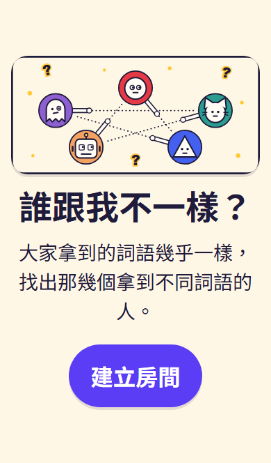
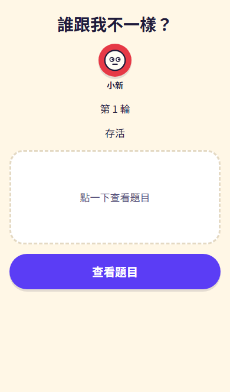

# QA 角色 1：第一次玩的新手

**目標：** 不看說明，能不能加入、看到題目、看懂淘汰揭曉。
**腳本：** `role1-newbie.mjs`　**Game ID：** `3678f5ee-812f-41bb-b17a-7bbf9690c57f`　**房間：** `3RSVAG`

## 做了什麼

| 步驟                                     | 結果                                                                                                                |
| ---------------------------------------- | ------------------------------------------------------------------------------------------------------------------- |
| 手機直接打開首頁（沒掃 QR Code）         | 只有標題、一句說明和「建立房間」。**沒有輸入房間代碼的地方**（QA-03）。                                             |
| 打開房間連結，什麼都不填就按「加入」     | 顯示「請輸入暱稱」。                                                                                                |
| 填暱稱「小新」加入                       | 進入「等待主持人開始」畫面，主持人名單立刻出現。                                                                    |
| 用小寫的房間代碼（`/room/3rsvag`）加入   | 可以加入。                                                                                                          |
| 用不存在的代碼 `ZZZZZZ` 加入             | 顯示「找不到這個房間，請確認房間代碼」。                                                                            |
| 4 人齊，主持人開始                       | 主持人看到 Round 1，手機看到「點一下查看題目」。                                                                    |
| 手機題目卡上有沒有說「要拿詞語做什麼」   | 沒有。卡片只有暱稱、輪數、存活、查看題目。說明只在主持人大螢幕（QA-04）。                                           |
| 4 人各自查看題目                         | 3 人是「公車」，1 人是「計程車」，查看後再隱藏都正常。                                                              |
| 主持人淘汰「小新」（拿「公車」，是平民） | 主持人畫面「淘汰的是平民！糟糕！你們抓錯人了！」；小新的手機「你被淘汰了」；其他人的手機「小新 被淘汰了，是平民」。 |

## 結果

- 流程走得通，沒有卡住的地方，錯誤訊息都看得懂。
- 發現 [QA-03](bugs.md#qa-03)、[QA-04](bugs.md#qa-04)，都是 P3。

## 證據

- `qa/01-new-player/results.log`、截圖（本機）。
- 手機首頁：
- 題目卡（隱藏時）：

## 備註

`host-reveal.png` 是在揭曉動畫進行中截的（標題還在淡入），不是畫面壞掉。
