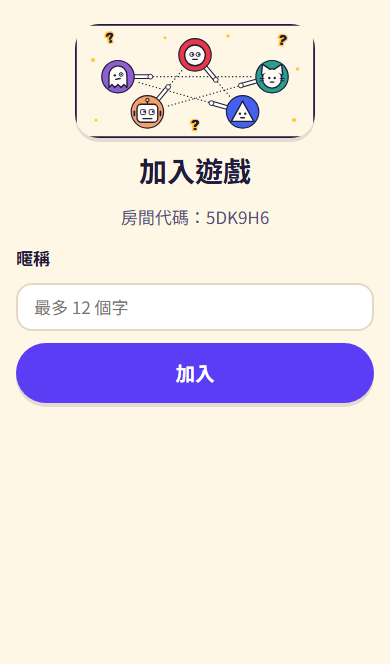

# QA 角色 3：不斷重新整理的玩家

**目標：** 每個 phase 都重新整理主持人與玩家頁面，要能接回原本的狀態，不能多出玩家、不能重新開始、不能讓題目留在畫面上。
**腳本：** `role3-refresher.mjs`　**Game ID：** `64bb5df4-6908-4e7d-95a2-d7038de2ef45`（整場）、`54f60be4-6acb-40af-8b80-46aaa9e8f2fd`（重設後再開一場）　**房間：** `5DK9H6`

## 做了什麼與結果

5 位玩家，主持人與玩家頁都用 `page.reload()`。

| Phase                         | 操作                             | 結果                                                                                              |
| ----------------------------- | -------------------------------- | ------------------------------------------------------------------------------------------------- |
| Lobby                         | 玩家連續重新整理 5 次            | 仍是同一個座位，「目前 5 人」                                                                     |
| Lobby                         | 主持人重新整理                   | 房間代碼、5 / 15、名單都在；`PLAYER_JOINED` 仍是 5 筆（重新整理不會多出玩家）                     |
| Playing                       | 玩家在題目顯示中重新整理         | 題目**重新隱藏**（DOM 沒有詞語節點），再查看是同一個詞                                            |
| Playing                       | 主持人重新整理 4 次              | 仍是 Round 1；`GAME_STARTED` 仍是 1 筆                                                            |
| Playing                       | 主持人開著淘汰確認視窗時重新整理 | 視窗消失，沒有淘汰任何人                                                                          |
| Reveal                        | 主持人重新整理                   | 回到「淘汰的是平民！」與「下一輪」                                                                |
| Reveal                        | 被淘汰的玩家重新整理             | 「你被淘汰了」，已淘汰                                                                            |
| Reveal                        | 存活玩家重新整理                 | 看到「甲 被淘汰了，是平民」，題目隱藏，詞語不變                                                   |
| Round 2                       | 主持人重新整理                   | 仍是 Round 2，被淘汰者頭像仍是停用                                                                |
| Finished                      | 主持人與玩家重新整理             | 回到結果畫面（「臥底獲勝！」、詞語、淘汰紀錄）；玩家看到「遊戲結束…請看大螢幕」                   |
| 重設後（再玩一場）            | 主持人與玩家重新整理             | 回到 Lobby，5 人都在                                                                              |
| 遊戲中清掉玩家的 localStorage | 重新整理                         | 回到加入表單；用同暱稱再加入，得到「遊戲已經開始，現在不能加入」。**這位玩家回不去了**（QA-06）。 |

## 發現

- 重新整理本身沒有造成任何問題：沒有重複玩家、沒有重複開始、沒有淘汰到別人。
- 遊戲中弄丟 Token（清除網站資料、換瀏覽器）就沒辦法回到原座位，也沒有任何提示該找誰。這是 PRD 沒要求的功能，記為 [QA-06](bugs.md#qa-06)（P3，同時列入已知限制）。

## 證據

`qa/03-refresher/results.log`、截圖（本機）。
遺失 Token 的畫面：
