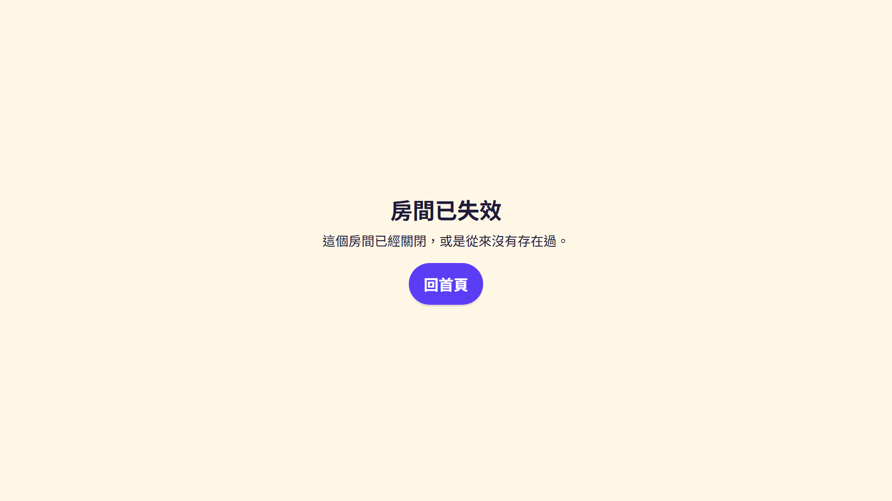

# QA 角色 6：操作主持人介面的使用者

**目標：** 連點淘汰、在錯的 phase 按按鈕、開兩個主持人分頁，遊戲狀態不能壞。
**腳本：** `role6-host.mjs`（連點的部分見 [02-repeat-clicker.md](02-repeat-clicker.md)）　**Game ID：** `a9151f3b-7904-4f33-9b5a-692db4ce8518`

## 結果

| 情境                                                    | 結果                                                                                           |
| ------------------------------------------------------- | ---------------------------------------------------------------------------------------------- |
| 0 人、3 人時「開始遊戲」                                | 停用                                                                                           |
| 4 人                                                    | 啟用                                                                                           |
| 第 16 位玩家加入（用 11 個 socket 加上手機湊滿 15 人）  | 手機顯示「房間已經滿了」                                                                       |
| Lobby 時用主持人自己的 Token 送淘汰、跳過、下一輪       | `INVALID_PHASE`                                                                                |
| Lobby 時送 `game:reset`                                 | 回 ok，Server 記成 `OPERATION_IGNORED`，沒有任何變化（設計如此：重複或不適用的操作視為已完成） |
| 開第二個主持人分頁（同瀏覽器，同 localStorage）         | 分頁 B 接上同一個房間，名單一致                                                                |
| 兩個分頁同時按「開始遊戲」                              | 只開一場（`GAME_STARTED` 1 筆）                                                                |
| 分頁 B 開著淘汰確認視窗，分頁 A 淘汰別人                | B 的視窗在 phase 改變時消失，B 切到揭曉畫面，沒有誤淘汰                                        |
| 兩個分頁同時按「下一輪」                                | 只進一輪（`ROUND_STARTED` 第 1、2 輪各 1 筆）                                                  |
| 遊戲進行中送 `game:start`、`game:next-round`            | 回 ok，記成 `OPERATION_IGNORED`，遊戲不變                                                      |
| 遊戲進行中送 `game:reset`                               | `INVALID_PHASE`                                                                                |
| 送舊的輪數（`roundNumber: 1`，實際第 2 輪）的淘汰或跳過 | `ROUND_MISMATCH`                                                                               |
| 淘汰不存在的 ID                                         | `PLAYER_NOT_FOUND`                                                                             |
| 淘汰已被淘汰的玩家（畫面上點不到，用 socket）           | `ALREADY_ELIMINATED`                                                                           |
| 「本輪無人淘汰」確認後                                  | 進入 Round 3，手機顯示「第 3 輪」，淘汰紀錄寫「第 2 輪：無人淘汰」                             |
| 分頁 B 開著「本輪無人淘汰」視窗，分頁 A 淘汰別人        | B 的視窗消失                                                                                   |
| 打到結束，兩個分頁同時按「再玩一場」                    | 只重設一次（`GAME_RESET` 1 筆）                                                                |
| 關掉主持人分頁，用同一個瀏覽器重新打開 `/host/<roomId>` | 回到原房間與控制權；關掉期間手機維持原狀                                                       |
| **換另一個瀏覽器開 `/host/<roomId>`**                   | 顯示「房間已失效…從來沒有存在過」，但房間其實還在（QA-02，P3）                                 |

整輪操作後 Log 裡只有預期的 `OPERATION_IGNORED`、`OPERATION_REJECTED`，沒有 `SERVER_ERROR`。

## 發現

- 所有主持人操作的錯誤情況都由 Server 判斷並擋下，兩個分頁不會把遊戲弄壞。
- [QA-02](bugs.md#qa-02)：主持人的 Token 只存在開房間那個瀏覽器的 localStorage。換瀏覽器、清除網站資料後，畫面說房間已失效，實際上房間還在，玩家還在等。沒有任何復原方式。

## 證據

`qa/06-host-ui/results.log`、`qa/06-host-ui/stdout.log`、截圖（本機）。
換瀏覽器開主持人網址：

## 備註

腳本第一次跑時卡在等待 `room:state` 事件（`host:auth` 的結果是放在回應裡，不是另外的事件），是腳本寫錯，修正後重跑，以上是修正後那一次的結果。
