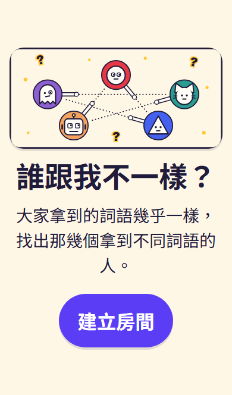
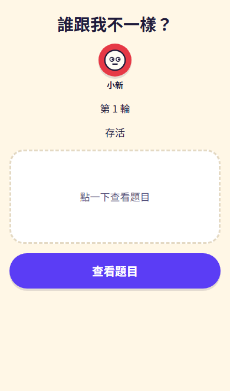
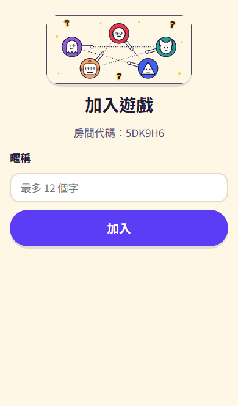

# QA 發現的問題

探索式 QA 一共記下 9 筆：2 筆 P2、7 筆 P3。**沒有 P0，也沒有 P1。** 所以這一票沒有另外開修復分支，全部列進 [known-limitations.md](../known-limitations.md)。

嚴重程度：P0 壞掉或洩漏秘密、P1 驗收條件沒達成或使用者一定遇到的錯、P2 該修但不擋、P3 小問題或建議。

整個 QA 期間（18 場遊戲、325 個房間、約 1300 筆事件）Event Log 沒有 `SERVER_ERROR`，Server 輸出沒有任何 error 行（`qa/server.log`）。

| 編號            | 嚴重度 | 摘要                                                          | 角色            |
| --------------- | ------ | ------------------------------------------------------------- | --------------- |
| [QA-01](#qa-01) | P2     | 手機網路無聲中斷時，畫面最久停 45 秒才發現                    | 4               |
| [QA-09](#qa-09) | P2     | 首頁在連線完成前按「建立房間」會跳出錯誤提示                  | 全跑 E2E 時發現 |
| [QA-02](#qa-02) | P3     | 沒有主持人 Token 時，主持人網址說「房間已失效」，實際房間還在 | 5、6            |
| [QA-03](#qa-03) | P3     | 手機首頁沒有輸入房間代碼的地方                                | 1               |
| [QA-04](#qa-04) | P3     | 玩家題目卡沒說明拿到詞語後要做什麼                            | 1               |
| [QA-05](#qa-05) | P3     | 程式內同步連點會建出多個房間、離開時跳出多個錯誤提示          | 2               |
| [QA-06](#qa-06) | P3     | 遊戲中弄丟 Token 的玩家回不去原座位                           | 3               |
| [QA-07](#qa-07) | P3     | 限流以連線為單位，多開連線就繞過；可以大量建房間              | 5               |
| [QA-08](#qa-08) | P3     | 回應標頭帶 `X-Powered-By: Express`                            | 5               |

## QA-01

**P2　手機網路無聲中斷時，畫面最久停 45 秒才發現**

- **重現：** 5 人遊戲進行中。讓其中一位手機與 Server 之間的 TCP 連線「無聲中斷」（不關閉、沒有封包，等於手機從 Wi-Fi 切到行動網路）。主持人在 0.6 秒後淘汰這位玩家。腳本：`role4b-silent-drop.mjs`。
- **預期：** 幾秒內手機偵測到連線有問題，顯示「連線中…」，重連後補上「你被淘汰了」。
- **實際：** 手機在 44.9 秒才顯示「連線中…」，45.4 秒才補上淘汰狀態。這 45 秒內畫面維持舊狀態，沒有任何提示。
- **原因：** Server 沒設 `pingInterval`、`pingTimeout`，用預設的 25 秒與 20 秒。Client 要 45 秒沒收到 ping 才認定連線已死。PR-14 看到的「超過 30 秒」應該是同一個機制（推論，沒有重現那一次）。
- **證據：** `qa-scripts/role4b-silent-drop.mjs`、`qa/04-reconnect-silent-drop/results.log`、`phone-final.png`（本機）。細節見 [04-reconnect.md](04-reconnect.md)。
- **Game ID：** `c4d4fe10-f3b5-4763-a6c8-3e7294e3e299`
- **處理：** 不修（P2）。建議 `new Server(httpServer, { pingInterval: 10000, pingTimeout: 5000 })`，偵測時間降到 15 秒。要先在真機驗證不會讓手機鎖屏、短暫背景時過度斷線。見已知限制。

## QA-02

**P3　沒有主持人 Token 時，主持人網址說「房間已失效」，實際房間還在**

- **重現：** 用 A 瀏覽器建立房間並開始遊戲。在 B 瀏覽器（或同一個瀏覽器清除網站資料後）打開 `/host/<roomId>`。
- **預期：** 說明「這個瀏覽器不是開房間的那個主持人」，或提供復原方式。
- **實際：** 顯示「房間已失效。這個房間已經關閉，或是從來沒有存在過。」按鈕是「回首頁」。房間其實還在，玩家還在等，沒有人能控制。同樣的訊息也出現在：玩家把自己的 Token 改成亂碼後（Token 前綴不是任何房間）。
- **證據：** `qa/06-host-ui/host-other-browser.png`、`qa/05-peeker/results.log`（`fresh browser on /host/<roomId>`）；圖：
- **Game ID：** `a9151f3b-7904-4f33-9b5a-692db4ce8518`
- **處理：** 不修。PRD 沒有主持人復原功能（不做登入）。後續改善：訊息分成「這個瀏覽器沒有主持權限」與「房間已失效」。

## QA-03

**P3　手機首頁沒有輸入房間代碼的地方**

- **重現：** 手機打開首頁（沒有掃 QR Code）。
- **預期：** 玩家可以輸入主持人螢幕上的 6 碼房間代碼。
- **實際：** 首頁只有「建立房間」。玩家只能掃 QR Code，或自己在網址列打 `/room/<代碼>`。
- **證據：** `qa/01-new-player/phone-home.png`；圖：
- **Game ID：** `3678f5ee-812f-41bb-b17a-7bbf9690c57f`
- **處理：** 不修。這是新功能，PRD 沒有，本票明確不做新功能。大螢幕上有完整連結可以輸入。後續改善：首頁加「輸入房間代碼」欄位。

## QA-04

**P3　玩家題目卡沒說明拿到詞語後要做什麼**

- **重現：** 加入並開始遊戲，看手機題目卡。
- **預期：** 第一次玩的人知道要「描述自己的詞語，但不要直接說出來」。
- **實際：** 手機卡片只有暱稱、輪數、存活、查看題目。這句話只出現在主持人大螢幕（「請大家輪流描述自己的詞語，描述完後現場投票」）。
- **證據：** `qa/01-new-player/results.log`；圖：
- **Game ID：** `3678f5ee-812f-41bb-b17a-7bbf9690c57f`
- **處理：** 不修。遊戲在同一個房間面對面玩，大螢幕與口頭說明可以補。後續改善：在題目卡加一行提示。

## QA-05

**P3　程式內同步連點會建出多個房間、離開時跳出多個錯誤提示**

- **重現：** 對「建立房間」按鈕在同一個工作裡呼叫 6 次 `click()`；對離開確認視窗的「確定」呼叫 6 次。腳本：`role2-repeat-clicker.mjs`。
- **預期：** 只建 1 個房間；離開只送 1 次。
- **實際：** 建出 6 個房間（`ROOM_CREATED` +6）；離開送出 6 次 `room:leave`，後 5 次被 Server 回 `UNAUTHENTICATED`，畫面跳 5 個錯誤提示。
- **真實雙擊（Playwright `dblclick`）不會發生**，1 個房間、0 個錯誤提示（`role2b-realistic-dblclick.mjs`）。人手連點不會踩到，網路很慢時才有機會。
- **證據：** `qa/02-repeat-clicker/results.log`、`after-leave.png`、`qa/02-repeat-clicker-real/results.log`
- **Game ID：** `31c70bb7-22aa-4cd4-8054-7cdfbb5e823d`（同一場 QA 的遊戲；建房間與離開發生在 Lobby，沒有自己的 Game ID）
- **處理：** 不修。後果只是多出空房間（2 小時後清除）與錯誤提示。

## QA-06

**P3　遊戲中弄丟 Token 的玩家回不去原座位**

- **重現：** 遊戲進行中，在某位玩家手機清除網站資料（或換瀏覽器），重新打開房間連結，用同暱稱加入。腳本：`role3-refresher.mjs`。
- **預期：** 能回到自己的座位，或有人告訴他該怎麼辦。
- **實際：** 看到加入表單，加入後得到「遊戲已經開始，現在不能加入」。原座位在主持人名單上一直顯示離線，直到這場結束。
- **證據：** `qa/03-refresher/results.log`；圖：
- **Game ID：** `64bb5df4-6908-4e7d-95a2-d7038de2ef45`
- **處理：** 不修。PRD 沒有主持人移除或救援玩家的功能（總覽假設 1：不做踢人），不做登入。

## QA-07

**P3　限流以連線為單位，多開連線就繞過；可以大量建房間**

- **重現：** 用 Node 開 30 條 socket，各送 10 個 `room:create`；或 25 條 socket 各送 10 個 `player:auth`。腳本：`role5-peeker.mjs`。
- **預期：** 對同一個來源的請求有整體上限。
- **實際：** 單一連線每秒 10 個請求的限制有效，但開多條連線就繞過：0.7 秒建出 300 個房間，0.6 秒內 250 次 Token 猜測全部進到檢查。
- **影響：** 猜 Token 不可行（256 位元），只是資源耗用：每個房間會在記憶體留 2 小時。範圍是區網派對，PRD 沒有要求防 DoS。
- **證據：** `qa/05-peeker/results.log`
- **Game ID：** 無（房間層級）
- **處理：** 不修。公開部署時建議在反向代理限制每個 IP 的連線與請求數（見 [deployment.md](../deployment.md)）。

## QA-08

**P3　回應標頭帶 `X-Powered-By: Express`**

- **重現：** `curl -I http://localhost:3200/`。
- **預期：** 不暴露框架。
- **實際：** 有 `X-Powered-By: Express`。
- **處理：** 不修。只是資訊，沒有秘密。後續改善：`app.disable('x-powered-by')`。
- **證據：** `qa/05-peeker/results.log`
- **Game ID：** 無

## QA-09

**P2　首頁在連線完成前按「建立房間」會跳出錯誤提示**

- **重現：** 打開首頁，在 Socket.IO 連上之前就按「建立房間」。腳本 `role6b-click-before-connected.mjs` 把 `/socket.io/` 的回應延遲 1.5 秒，頁面載入後立刻按。
- **預期：** 等連線完成後再建立，或按鈕先停用。
- **實際：** 網址不變，跳出「連線或伺服器出了問題，請稍後再試」。再按一次才會成功。原因是 `ConnectionStore.request` 在 `socket.connected` 為 false 時直接回失敗（刻意不讓請求排隊，避免在驗證前被送出），首頁的按鈕沒有看連線狀態。
- **怎麼發現的：** 本機用預設 workers（這台 16 核心，Playwright 開 8 個 worker）跑完整 E2E，連續兩次各有 1 個測試在 `createHost` 失敗（`expect(page).toHaveURL(//host/.+/)` 逾時），頁面截圖上就是這個錯誤提示。兩次失敗的測試不同（`player-card.spec.ts` 的情境 8、`start.spec.ts` 的 10 人開始），原因相同。改用 `--workers=2`（CI 的設定）後通過。第一次失敗的 `e2e.log` 被後來的重跑覆蓋，第二次的紀錄是 `e2e-default-workers-run2.log`。
- **加入表單沒有這個問題：** `PlayerPage` 在連線完成前只顯示「連線中…」，表單根本還沒出現（同一支腳本，第二段，「加入」正常）。
- **證據：** `qa/06-click-before-connected/results.log`、`home-click-before-connected.png`（本機）、`e2e-default-workers-run2.log`。
- **Game ID：** 無（還沒建房間）
- **處理：** 不修（P2）。建議在 `HomePage` 用 `useConnected()` 讓按鈕在連線前停用，或讓建立房間等到連線。順帶會讓 E2E 在高負載下更穩。我把它當成最值得優先修的一筆，因為它有實際重現，修起來只有幾行。
